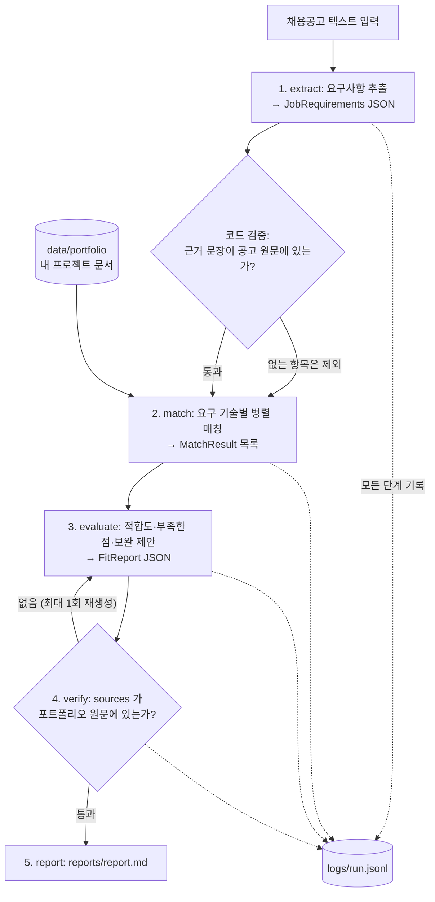

# FitCheck

> AI workflow that matches job postings to your portfolio.
> 채용공고에서 요구 기술을 뽑아 내 포트폴리오와 비교하고, 부족한 점과 보완 방법을 알려 주는 Workflow 프로젝트

지능시스템 수업 "Workflow / AI Agent 개발 과제" 제출물입니다.

## 1. 해결하려는 문제

채용공고를 볼 때마다 "내 프로젝트 중 무엇이 이 공고에 맞는지, 무엇이 부족한지"를 직접 비교하는 데 시간이 걸립니다.
FitCheck는 공고 텍스트를 입력하면 요구 기술을 구조화해 추출하고, 내 포트폴리오 문서에서 **근거를 찾아** 적합도 리포트를 만들어 줍니다.

## 2. 왜 Agent가 아니라 Workflow인가

수업(7·10주차)의 판단 기준을 그대로 적용했습니다.

| 질문                                   | 답                               | 결론                                |
| -------------------------------------- | -------------------------------- | ----------------------------------- |
| 처리 순서가 미리 정해져 있는가?        | 예 (추출 → 매칭 → 평가 → 검증)   | Agent의 자율 판단 불필요 → Workflow |
| 하위 작업을 독립적으로 나눌 수 있는가? | 예 (요구 기술별 매칭)            | Parallelization                     |
| 결과가 사실인지 확인이 필요한가?       | 예 (없는 경험을 지어내면 치명적) | Evaluator(검증)                     |

사용한 패턴: **Chaining + Parallelization + Evaluator**

## 3. 처리 흐름도



## 4. 사용 기술

- Python 3
- Gemini API (`google-genai`): 구조화된 출력(JSON schema)으로 응답 형식을 강제
- Pydantic: 단계 사이에 주고받는 데이터 계약(스키마) 정의 및 검증
- `concurrent.futures.ThreadPoolExecutor`: 요구 기술별 병렬 매칭
- python-dotenv: API 키를 `.env`로 분리

## 5. 실행 방법

```bash
git clone <저장소 URL>
cd fitcheck
pip install -r requirements.txt

cp .env.example .env     # 열어서 GEMINI_API_KEY 와 FITCHECK_MODEL 을 채운다

python main.py data/sample_jd.txt
python main.py data/sample_jd_injection.txt --out reports/injection.md
```

- 포트폴리오는 `data/portfolio/` 아래에 프로젝트마다 마크다운 파일 하나씩 둡니다. (현재 파일은 모두 더미 데이터)
- LLM 없이 흐름만 검증하는 테스트: `python -m unittest discover -s tests -v`

## 6. 설계 원칙 (수업 내용 적용)

| 원칙                                                                | 적용 위치                                                   |
| ------------------------------------------------------------------- | ----------------------------------------------------------- |
| 단계 사이에는 자연어 요약이 아니라 구조화된 JSON만 넘긴다           | `schemas.py`                                                |
| 점수 대신 근거(인용)를 요구하고, 코드로 근거를 다시 검증한다        | `extract.py`, `match.py`, `verify.py`                       |
| 외부 문서는 신뢰하지 않는 데이터로 취급한다 (Prompt Injection 방어) | `llm.py`의 `wrap_untrusted`, `data/sample_jd_injection.txt` |
| 재시도·재생성 횟수에 한도를 둔다 (무한 루프 방지)                   | `llm.py`(max_retries), `pipeline.py`(max_regen)             |
| 단계마다 실행 기록을 남긴다                                         | `logs/run.jsonl`                                            |

## 7. 폴더 구조

```
fitcheck/
├── main.py               # 실행 진입점 (CLI)
├── fitcheck/
│   ├── schemas.py        # 데이터 계약 (Pydantic)
│   ├── llm.py            # Gemini 호출 + 재시도 + 기록
│   ├── extract.py        # 1. 공고 → 요구사항
│   ├── match.py          # 2. 요구 기술별 병렬 매칭
│   ├── evaluate.py       # 3. 적합도 평가
│   ├── verify.py         # 4. 근거 검증
│   ├── pipeline.py       # 전체 흐름 연결
│   ├── report.py         # 5. 마크다운 리포트
│   └── portfolio.py      # 포트폴리오 문서 로딩
├── data/                 # 샘플 공고, 더미 포트폴리오
├── tests/                # LLM 없이 흐름을 검증하는 테스트
├── reports/              # 생성된 리포트
└── docs/                 # 스크린샷 등
```

## 8. 실행 결과

> TODO: 실행 후 스크린샷을 `docs/`에 넣고 아래에 연결합니다.
>
> - 정상 공고(`sample_jd.txt`) 결과
> - Prompt Injection 공고(`sample_jd_injection.txt`) 결과

## 9. 한계와 확장

- **검증의 한계**: `verify`는 `sources`의 문장이 포트폴리오 원문에 존재하는지만 확인합니다. `strengths` 문장이 근거와 의미상 맞는지까지는 확인하지 못합니다. 별도 LLM 검증 단계를 추가하면 보완할 수 있습니다.
- **포트폴리오 규모**: 현재는 문서 전체를 컨텍스트에 넣습니다. 프로젝트가 많아지면 `match.py`를 임베딩 검색(RAG)으로 교체할 수 있습니다.
- **무료 티어 제한**: 병렬 호출 수(`max_workers`)를 3으로 제한했습니다. 한도는 사용 중인 모델과 계정에 따라 다를 수 있습니다.
- **화면**: 현재는 CLI와 마크다운 리포트입니다. Streamlit 화면을 얹을 수 있게 로직(`fitcheck/`)과 진입점을 분리해 두었습니다.

## 10. 활용한 도구와 출처

- 설계 논의와 코드 초안 작성에 AI 도구(Claude)를 활용했고, 이후 직접 검토·수정했습니다. (TODO: 본인이 직접 수정·구현한 부분을 구체적으로 적기)
- LLM API: Google Gemini API
- 라이브러리: google-genai, pydantic, python-dotenv
- 설계 근거: 지능시스템 수업 자료 (7주차 Workflow 패턴, 10주차 Multi-Agent·설계 원칙, 5주차 프롬프트 보안)
